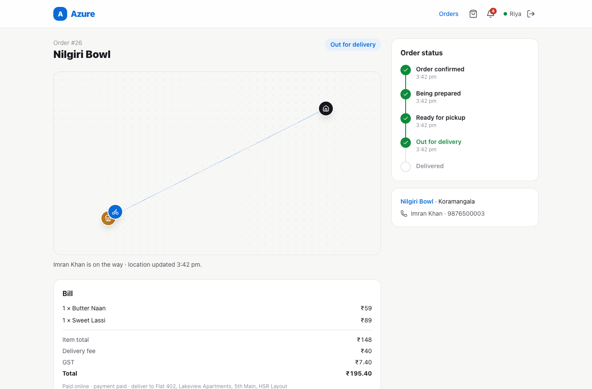
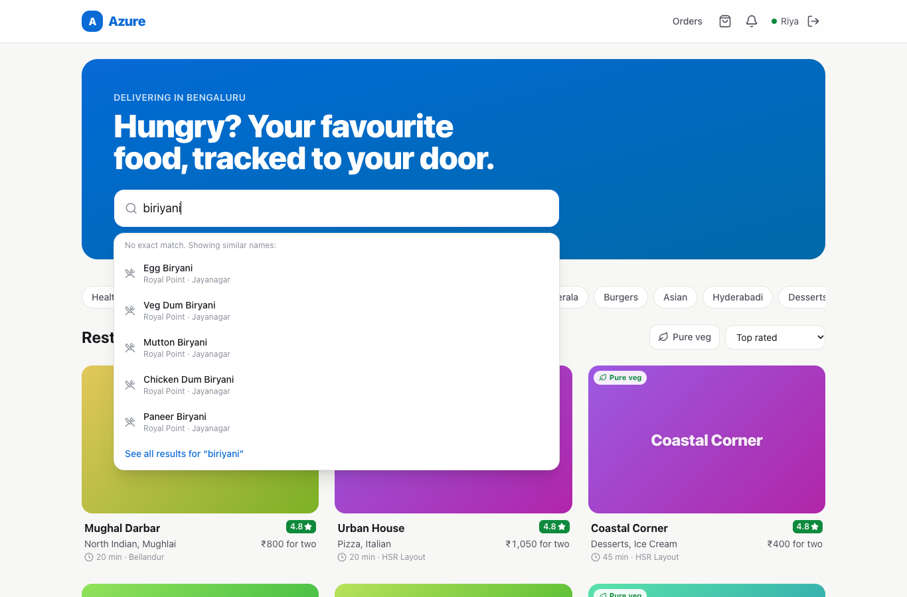
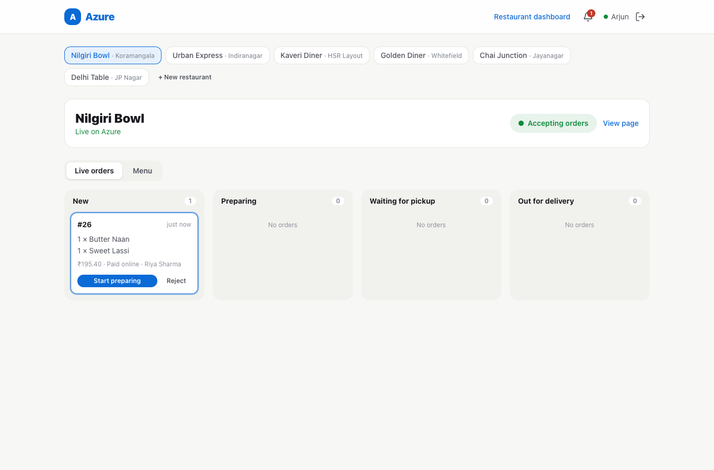
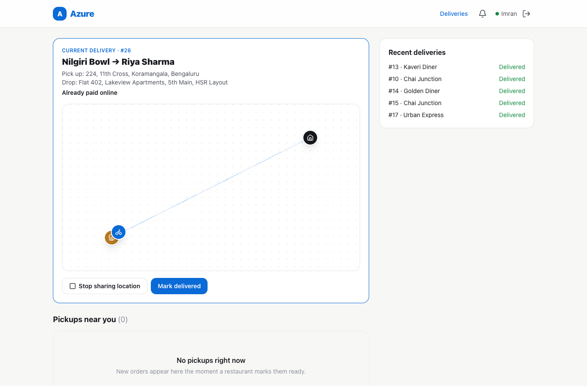
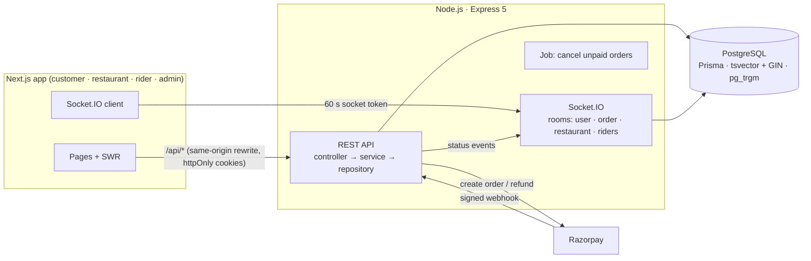

# Azure · Food delivery platform

A full-stack food delivery app for four kinds of users: **customers** order and track food live, **restaurant owners** run a live orders board and manage their menu, **delivery partners** pick up orders and share their location, and **admins** approve restaurants and manage users.

**Stack:** Next.js 16 + TypeScript (frontend) · Node.js, Express 5 + TypeScript (REST API + Socket.IO) · PostgreSQL 16 + Prisma 7 · Razorpay · Docker · GitHub Actions



## What it does

| | |
|---|---|
| **Search** | PostgreSQL full-text search (weighted `tsvector` + GIN index) over restaurants and dishes, with prefix matching while you type and a trigram (`pg_trgm`) fallback for typos: "biriyani" finds Biryani. Debounced type-ahead that cancels stale requests. |
| **Ordering** | Cart → server-priced quote → order. The client never sends prices: totals, GST and delivery fee are computed on the server from database prices, in integer paise. Retried "place order" requests are de-duplicated with an `Idempotency-Key`. |
| **Payments** | Razorpay: server-side order creation, HMAC-SHA256 signature verification of the checkout callback, signed + de-duplicated webhooks, automatic refunds. A built-in test gateway implements the same signature scheme, so everything runs and is tested without API keys. |
| **Order lifecycle** | 7 statuses (`PENDING → CONFIRMED → PREPARING → READY → OUT_FOR_DELIVERY → DELIVERED`, or `CANCELLED`) enforced by a state machine on the server, with role checks for every move and a full status history. |
| **Real time** | Socket.IO rooms per user, order, restaurant and rider pool: restaurants get new orders instantly, riders see pickups appear and disappear, customers watch status changes and the rider's live location. |
| **Auth & security** | JWT access tokens + rotating refresh tokens in httpOnly cookies, with reuse detection; role-based access control; bcrypt; rate-limited login; Helmet; Zod validation on every input. |

| Customer: search with typo tolerance | Restaurant: live orders board | Delivery partner |
|---|---|---|
|  |  |  |

## Measured results

| | Result | How to reproduce |
|---|---|---|
| Automated tests | **61 integration and unit tests** (Jest + Supertest + real Socket.IO clients) against a real PostgreSQL database | `cd backend && npm test` |
| End-to-end in a real browser | Customer pays online → restaurant prepares → rider accepts and rides → customer tracks live and rates, **3 users at once**, 0 console errors | `node e2e/full-flow.mjs` |
| Search speed | **p50 24 ms, p95 56 ms** over **50,921 menu items** (5,000 restaurants), ranked restaurants + dishes. A naive `ILIKE '%term%'` on dishes alone: p50 38 ms | `SEED_RESTAURANTS=5000 npm run db:seed` then `npm run bench:search` |
| Race conditions | 5 riders accepting one order at once → exactly 1 wins; 3 simultaneous "place order" retries → 1 order; browser + webhook confirming one payment together → confirmed once | in the test suite |

Benchmarks ran on one laptop (Apple Silicon); treat them as relative, not production capacity.

## Architecture



```
backend/src/
  config/        env (validated with Zod), Prisma client, logger
  middlewares/   authenticate, authorize(role), rate limit, error handler
  modules/       auth · restaurants · search · orders · payments · notifications · admin
                 (each: routes → controller → service → repository, Zod validators)
  socket/        Socket.IO server + a small realtime facade used by services
  jobs/          background job (expire unpaid online orders)
backend/prisma/  schema, migrations (incl. search triggers), seed
frontend/app/    / · /search · /restaurants/[slug] · /cart · /orders/[id] · /partner · /rider · /admin
e2e/             headless-Chrome full-flow test
```

## Design decisions (and why)

- **Money as integer paise.** Floats can't represent 0.1 exactly. `29900` = ₹299; GST is rounded half-up in integer maths. A DB `CHECK` guarantees `total = itemsTotal + deliveryFee + taxes`.
- **Server-side pricing.** The order API accepts only menu item ids and quantities. A tampered client can't change a price.
- **Atomic state transitions.** Each status change is a single `UPDATE … WHERE id = ? AND status IN (allowed sources)`, so the check and the change can't be separated by a race. That is how exactly one of several riders wins a pickup, and why a late payment can't revive an expired order.
- **Payment confirmed exactly once.** The browser callback and the Razorpay webhook may arrive together and more than once. The payment row moves to `PAID` with a compare-and-set, webhook event ids are stored to drop duplicates, and the webhook signature is checked over the raw request bytes. A payment that lands after its order expired is refunded automatically.
- **Refresh-token rotation with reuse detection.** Refresh tokens are random, stored only as SHA-256 hashes, and replaced on every use. Presenting an already-replaced token means it was copied, so the whole session family is revoked. Two tabs refreshing at the same instant are recognised and don't log the user out.
- **Full-text search maintained by triggers.** `tsvector` columns weight name above cuisine/category above description and are kept up to date by Postgres triggers. (Generated columns would have worked in SQL, but Prisma reads them as defaults and keeps trying to drop them.) Finished words use English stemming; the word being typed uses a `simple` prefix query, because stemming turns "biry" into "biri", which wouldn't match "biryani".
- **Same-origin API.** Next.js rewrites `/api/*` to Express, so auth cookies are first-party and there is no CORS for REST. The socket connects directly with a 60-second token from `/auth/socket-token`.

## Run it locally

Requirements: Node.js 20+ and Docker.

```bash
docker compose up -d db                      # PostgreSQL on localhost:55433 (dev + test databases)

cd backend
cp .env.example .env
npm install
npx prisma migrate deploy && npm run db:seed # ~120 Bengaluru restaurants, demo accounts
npm run dev                                  # API on http://localhost:5001/api/v1

cd ../frontend
npm install
npm run dev                                  # app on http://localhost:3000
```

Demo accounts (password `Azure@123`), also one click away on the login page:

| Role | Email |
|---|---|
| Customer | customer@azure.dev |
| Restaurant owner | owner@azure.dev |
| Delivery partner | rider@azure.dev |
| Admin | admin@azure.dev |

**Razorpay:** put your test-mode keys in `backend/.env` (`RAZORPAY_KEY_ID`, `RAZORPAY_KEY_SECRET`, and `RAZORPAY_WEBHOOK_SECRET` for webhooks) to use real Razorpay Checkout. Without them, a built-in test gateway with the same HMAC signature scheme is used.

**Everything in Docker:** `docker compose --profile app up --build`, then seed with `docker compose exec backend npx prisma db seed` *(needs the seed's dev dependencies; easiest is to seed from your machine against port 55433)*.

## API overview

All routes are under `/api/v1`. Responses use `{ success, message, data, meta? }`; errors use `{ success: false, message, errors? }`.

| Area | Endpoints |
|---|---|
| Auth | `POST /auth/register` · `POST /auth/login` · `POST /auth/refresh` · `POST /auth/logout` · `POST /auth/logout-all` · `GET /auth/me` · `GET /auth/socket-token` |
| Restaurants | `GET /restaurants` (filters, sort, pagination) · `GET /restaurants/facets` · `GET /restaurants/:slug` · `GET /restaurants/:id/reviews` · owner: `GET /restaurants/mine` · `POST /restaurants` · `PATCH /restaurants/:id` · `PATCH /restaurants/:id/open` · `POST/PATCH/DELETE /restaurants/:id/menu-items[/:itemId]` |
| Search | `GET /search?q=` · `GET /search/suggest?q=` |
| Orders | `POST /orders/quote` · `POST /orders` (Idempotency-Key) · `GET /orders` · `GET /orders/:id` · `POST /orders/:id/cancel` · `POST /orders/:id/review` · restaurant: `GET /orders/restaurant` · `PATCH /orders/:id/status` · rider: `GET /orders/available` · `POST /orders/:id/claim` · `POST /orders/:id/deliver` · `GET /orders/deliveries` |
| Payments | `POST /payments/checkout` · `POST /payments/verify` · `POST /payments/webhook` |
| Other | `GET /notifications` · `POST /notifications/read-all` · admin: `GET /admin/stats` · `GET/PATCH /admin/restaurants` · `GET/PATCH /admin/users` |

## Not built yet

Google sign-in, image uploads, coupons, email/SMS notifications, real map tiles (the tracking map is schematic), and multi-instance scaling of Socket.IO (would use the Redis adapter). Not deployed publicly yet.
